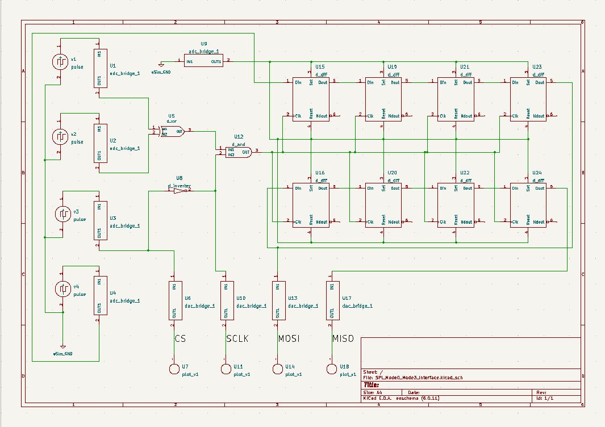
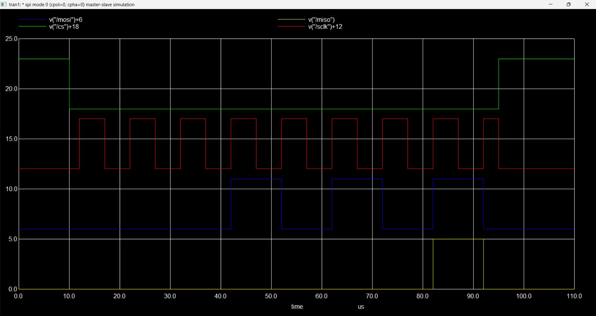
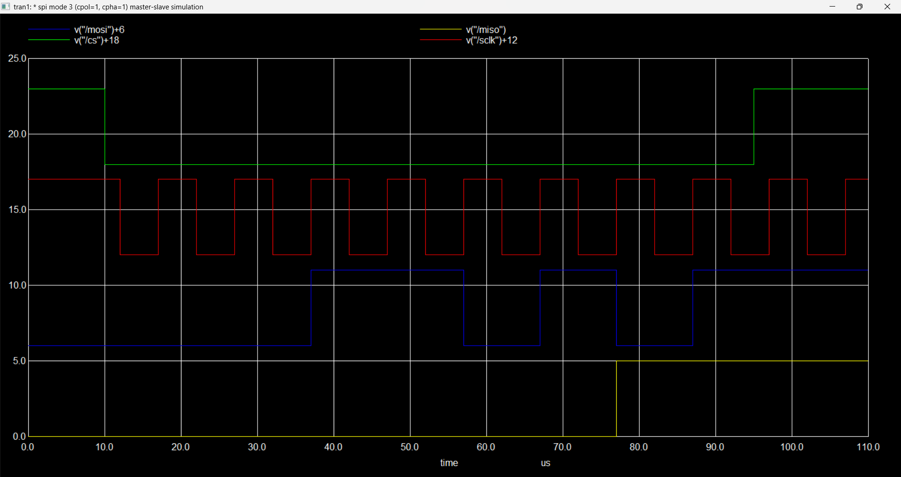

# Configurable SPI Master-Slave Interface (Mode 0 & Mode 3) in eSim

**EDA Tool:** `eSim 2.4` | `KiCad` | `Ngspice` &nbsp;•&nbsp; **Protocol:** `SPI Mode 0 & Mode 3` &nbsp;•&nbsp; **Program:** `FOSSEE Winter Internship 2026 (IIT Bombay)`

Circuit-level hardware modeling and Ngspice transient verification of a **4-bit Serial Peripheral Interface (SPI)** Master-Slave communication system supporting dynamic Clock Polarity (`CPOL`) and Clock Phase (`CPHA`) switching between **SPI Mode 0** and **SPI Mode 3**.

---

## 1. Architecture & Circuit Schematic
Built using `eSim_Sources`, `eSim_Hybrid`, `eSim_Digital`, and `eSim_Plot` libraries:
* **Clock Polarity & Chip Select Logic (`d_xor`, `d_inverter`, `d_and`):** An XOR stage dynamically flips idle `SCLK` polarity between LOW (`CPOL = 0`, Mode 0) and HIGH (`CPOL = 1`, Mode 3), while an AND gate isolates the bus whenever active-low Chip Select (`CS`) is HIGH (`5V`).
* **4-Bit Master & Slave Shift Registers (`8 x d_dff`):** Two cascaded 4-bit shift registers connected in a full-duplex ring (`Master → MOSI → Slave → MISO`), shifting 1 bit per rising edge of `SCLK`.
* **Mixed-Signal Bridges (`adc_bridge_1`, `dac_bridge_1`):** Interfaces `0V/5V` transient pulse stimuli with XSPICE event-driven digital logic models.



---

## 2. Signal Pinout & Timing Verification Summary

| Signal | Direction | Voltage / Offset | Observed Hardware Behavior |
| :--- | :--- | :---: | :--- |
| **`CS`** | Master → Slave | `18V` (Low) / `23V` (High) | Drops LOW at `t = 10 µs` to enable Slave; returns HIGH at `t = 95 µs` to freeze shifting. |
| **`SCLK`** | Master → Slave | `12V` (Low) / `17V` (High) | Idles **LOW (`0V`)** in Mode 0; idles **HIGH (`5V`)** in Mode 3 (`100 kHz`, `10 µs` period). |
| **`MOSI`** | Master → Slave | `6V` (Low) / `11V` (High) | Shifts test bit pattern (`1, 0, 1, 0`) out of the 4-bit Master register starting at the 4th rising clock edge. |
| **`MISO`** | Slave → Master | `0V` (Low) / `5V` (High) | Captures `MOSI` bits in the Slave shift register and shifts them back to the Master 4 clock cycles later. |

---

## 3. Simulation Waveforms

### A. SPI Mode 0 (`CPOL = 0, CPHA = 0`) — Idle-LOW Clock
* `SCLK` (Red) stays **LOW** before `CS` (Green) asserts LOW at `10 µs`.
* Data bits (`1, 0, 1, 0`) emerge on `MOSI` (Blue) starting at `t = 42 µs` and appear on `MISO` (Yellow) at `t = 82 µs`.



### B. SPI Mode 3 (`CPOL = 1, CPHA = 1`) — Idle-HIGH Clock
* Setting `CPOL = 1` (`5V`) inverts `SCLK` (Red) to idle **HIGH (`5V`)**, creating an initial falling setup edge at `t = 12 µs` followed by rising sampling edges (`17 µs`, `27 µs`, `37 µs`, `47 µs`).



---

## 4. Hardware-to-Firmware Bridge (ATmega2560 Relevance)
Understanding this gate-level shift register and `CPOL`/`CPHA` XOR logic directly maps to configuring bare-metal microcontroller SPI peripherals (such as the **ATmega2560 `SPCR` register**):
* **Mode 0 (`CPOL=0, CPHA=0`):** `SPCR &= ~((1 << CPOL) | (1 << CPHA));`
* **Mode 3 (`CPOL=1, CPHA=1`):** `SPCR |= (1 << CPOL) | (1 << CPHA);`

---

## 5. How to Reproduce Locally (Ngspice CLI)
Clone or download this repository and run either netlist directly in Ngspice:
```bash
# Simulate SPI Mode 0 (CPOL = 0, CPHA = 0)
ngspice SPI_Mode0_Simulation.cir.out

# Simulate SPI Mode 3 (CPOL = 1, CPHA = 1)
ngspice SPI_Mode3_Interface.cir.out
```

---

## 6. Project Documentation
* 📄 **[Full Technical Report (`SPI_Mode0_Mode3_Report.pdf`)](SPI_Mode0_Mode3_Report.pdf)**
* 📄 **[Simulation Reproduction Guide (`README_Simulation_Guide.pdf`)](README_Simulation_Guide.pdf)**
